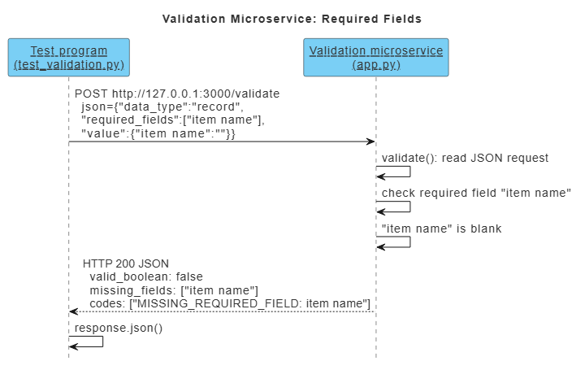

# Validation Microservice

A REST API microservice built using Python and Flask to validate user input before saving data.

## Features

- Required Fields: Checks whether required fields are missing or blank.
- Numeric Range: Checks whether a number falls within a specified range.
- Date Validation: Checks whether a date is valid and follows YYYY-MM-DD format.

## Setup

Install dependencies:

    pip install -r requirements.txt

Start the microservice:

    python3 app.py

The service runs at http://127.0.0.1:3000.

## Communication Contract

The microservice communicates using HTTP POST requests and JSON responses.

Endpoint: POST /validate

| Data Type | Request Fields | Purpose |
|---|---|---|
| record | data_type, value, required_fields | Validates required fields |
| numeric | data_type, value, min, max | Validates numeric ranges |
| date | data_type, value | Validates dates |

### Requesting and Receiving Data

Example JavaScript request:

    const response = await fetch("http://127.0.0.1:3000/validate", {
        method: "POST",
        headers: { "Content-Type": "application/json" },
        body: JSON.stringify({
            data_type: "numeric",
            value: 75,
            min: 0,
            max: 100
        })
    });

    const data = await response.json();
    console.log(data.valid_boolean);
    console.log(data.codes);

Example JSON response:

    {
        "valid_boolean": true,
        "original_value": 75,
        "codes": ["VALID"]
    }

The response includes:
- valid_boolean: Indicates whether the input passed validation.
- original_value: The value submitted for validation.
- codes: Validation results or error messages.
- missing_fields: Included for record validation.

Valid and invalid field values generally return HTTP 200 with their validation results. Malformed requests or unsupported data types return HTTP 400.

## Testing

Start the Flask server in one terminal:

    python3 app.py

Run the test program in another terminal:

    python3 test_validation.py

The test program sends requests to the microservice and checks the responses for all three user stories, error handling, and performance.

## UML Sequence Diagram

